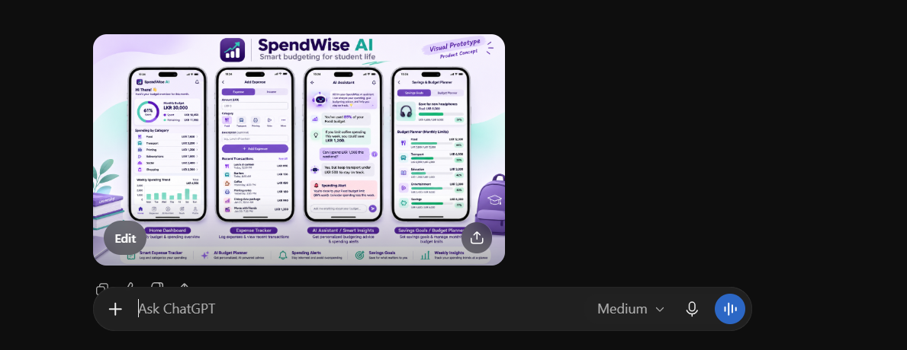

# Lab 02 – AI in Everyday Challenges

## 1. Laboratory Session

**Module:** PUSL3205 – Large Language Models and Generative AI

**Laboratory:** Lab 02 – AI in Everyday Challenges

**Group:** 8 – The Budget-Challenged Student

## 2. Objective

To apply a Large Language Model (LLM) as a product-development partner to address an everyday challenge faced by university students, improving problem-solving, critical thinking, and creativity.

## 3. Tasks and Implementation

The assigned challenge was to design an innovative product that helps university students understand, control, and manage their daily spending.

ChatGPT (OpenAI) was used as the LLM product-development partner.

The activity involved two main prompts:

1. **Product Concept Development:** ChatGPT was used to develop the proposed SpendWise AI product concept, including its functionality, key features, and target users.
2. **Visual Prototype Generation:** ChatGPT was used to generate a visual mock-up representing the proposed product's main features and interface.

The proposed product was developed as a concept and visual prototype rather than a functioning application.

## 4. Results and Evidence

### Product Name

**SpendWise AI – Smart Budgeting for Student Life**

### Product Concept

SpendWise AI is a proposed AI-powered budgeting application for university students. It helps students monitor daily expenses, manage limited budgets, identify spending patterns, and receive personalised budgeting suggestions.

### Key Features

- Smart Expense Tracker
- AI-Powered Budget Planner
- Smart Spending Alerts
- AI Financial Assistant
- Savings Goals and Challenges
- Weekly Spending Insights

### Target Users

University students managing allowances, part-time income, daily expenses, and personal savings goals.

### Visual Prototype

### Supporting Documentation

[Product Concept](group-activity/product-concept.md)

[LLM-Assisted Development Process](group-activity/llm-development-process.md)

[Product Development Outcomes](group-activity/activity-outcomes.md)

### LLM Interaction Evidence

**Prompt 1 – Product Concept Development**

[Prompt 1](./screenshots/Prompt01.png)

[Response 1 – Part 1](./screenshots/Response01_(01).png)

[Response 1 – Part 2](./screenshots/Response01_(02).png)

[Response 1 – Part 3](./screenshots/Response01_(03).png)

[Response 1 – Part 4](./screenshots/Response01_(04).png)

[Response 1 – Part 5](./screenshots/Response01_(05).png)

[Response 1 – Part 6](./screenshots/Response01_(06).png)

[Prompt 2](./screenshots/Prompt02.png)

[Generated Response](./screenshots/Response02.png)

## 5. Observations

ChatGPT helped develop a structured product concept and generate a visual prototype for the assigned student budgeting challenge.

The generated concept combines expense tracking with AI-assisted budgeting suggestions and financial planning features.

The visual mock-up illustrated the proposed application's main screens and provided a clearer understanding of how students could interact with the product.

A limitation is that the prototype represents a conceptual design rather than a functioning application. Its features have not been implemented or tested.

## 6. Learning Outcomes

Through this practical, I gained experience in:

- Applying an LLM to an everyday real-world problem.
- Using structured prompts for product concept development.
- Identifying relevant product features and target users.
- Generating visual prototypes using generative AI.
- Understanding the benefits and limitations of LLM-assisted product development.
- Documenting prompts, responses, and outcomes as evidence of practical work.